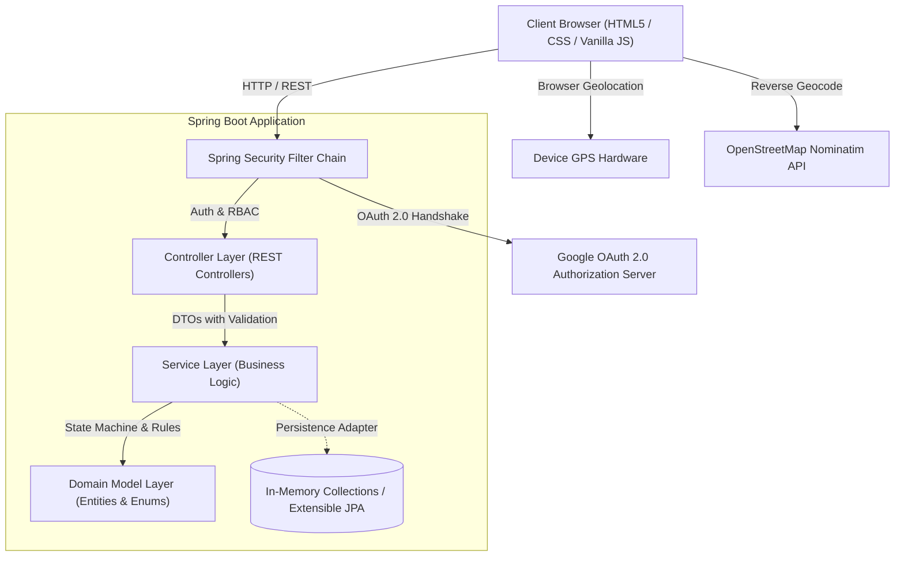
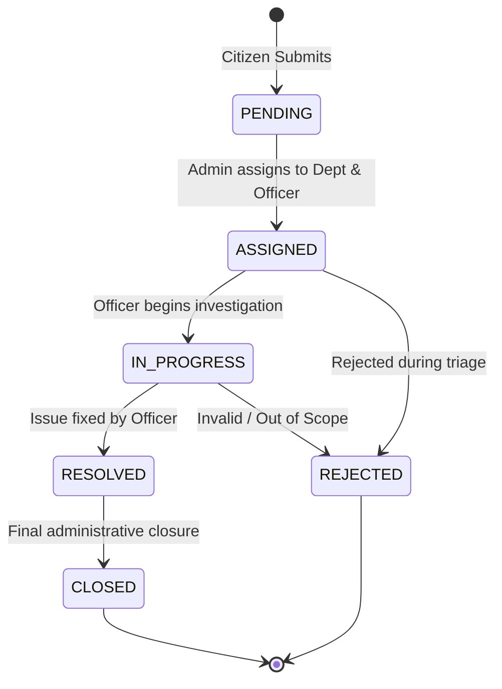

# Resolve | Civic Complaint Management System

A full-stack, enterprise-grade Civic Complaint Management platform built with **Java 17, Spring Boot, Spring Security, and Docker**. Designed to streamline the intake, assignment, resolution, and transparent tracking of civic issues across municipal departments.

---

## 🌟 Key Features

* **Citizen Portal**:
  * Public grievance filing with title, department, description, and location.
  * **Automated GPS & Reverse Geocoding**: HTML5 Geolocation API maps device coordinates to human-readable street addresses via OpenStreetMap (Nominatim).
  * **Amazon-Style Visual Progress Pipeline**: Tracks lifecycle milestones (`PENDING` → `ASSIGNED` → `IN_PROGRESS` → `RESOLVED` → `CLOSED` or `REJECTED`).
  * **Authentication-Guarded History**: Recent complaints and metrics are accessible after login to ensure privacy.
* **Administrative & Officer Workspace**:
  * Department management (Electrical, Water, Roads, Sanitation, Public Safety).
  * Staff and officer account provisioning linked to departments.
  * Two-stage triage: assign complaints to departments and designated officers with audit remarks.
  * Tabular segmentation of active vs. historical complaints.
* **Enterprise Security & Authentication**:
  * **Role-Based Access Control (RBAC)**: `CITIZEN`, `OFFICER`, and `ADMIN`.
  * **Dual Authentication**: Session-based email/password encryption via `BCryptPasswordEncoder` alongside **Google OAuth 2.0 Single Sign-On (SSO)**.
* **Production Ready**:
  * Multi-stage Docker containerization on Eclipse Temurin JRE (~150MB).
  * Cloud-ready dynamic port binding (`server.port=${PORT:8080}`) for zero-configuration PaaS deployment (Render, Railway).

---

## 🛠️ Technology Stack

| Domain | Technologies |
| :--- | :--- |
| **Backend** | Java 17 / 23, Spring Boot 4.x, Spring MVC, Spring Security, Springdoc OpenAPI |
| **Frontend** | Semantic HTML5, CSS3 Custom Properties, Vanilla JavaScript (ES6+ Fetch API) |
| **Authentication** | Spring Security Sessions, DaoAuthenticationProvider, BCrypt, Google OAuth2 Client |
| **Integrations** | Browser Geolocation API, OpenStreetMap Nominatim Reverse Geocoding API |
| **DevOps & Build** | Maven Wrapper (`mvnw`), Multi-stage Dockerfile, Git, Render PaaS |

---

## 🏛️ System Architecture



---

## 🔄 Complaint State Machine



---

## 🔐 Role-Based Access Control (RBAC) Matrix

| Endpoint / Action | Guest | Citizen | Officer | Admin |
| :--- | :---: | :---: | :---: | :---: |
| Browse homepage & departments (`GET /api/departments/**`) | ✅ | ✅ | ✅ | ✅ |
| Submit a new complaint (`POST /api/complaints`) | ✅ | ✅ | ✅ | ✅ |
| Citizen signup / login (`/api/auth/**`) | ✅ | ✅ | ✅ | ✅ |
| View recent complaints register (`GET /api/complaints/**`) | ❌ (401) | ✅ | ✅ | ✅ |
| View Amazon-style progress tracker | ❌ | ✅ | ✅ | ✅ |
| Update complaint workflow status (`PUT /api/complaints/*/status`) | ❌ | ❌ | ✅ | ✅ |
| Assign complaint to officer (`PUT /api/complaints/*/assign`) | ❌ | ❌ | ❌ | ✅ |
| Department & Staff CRUD (`/api/users/**`, `/admin.html`) | ❌ | ❌ | ❌ | ✅ |

---

## 📡 REST API Summary

### Authentication (`/api/auth`)
* `POST /api/auth/signup` - Register a new citizen account and auto-authenticate.
* `POST /api/auth/login` - Authenticate with email and password.
* `GET  /api/auth/me` - Retrieve the active user session profile.
* `POST /api/auth/logout` - Invalidate the active session.
* `GET  /oauth2/authorization/google` - Initiate Google OAuth2 login flow.

### Complaints (`/api/complaints`)
* `GET    /api/complaints` - List complaints (optional `?status=PENDING`). *(Requires Auth)*
* `GET    /api/complaints/{id}` - Retrieve details of a specific complaint. *(Requires Auth)*
* `POST   /api/complaints` - Submit a new civic complaint. *(Public)*
* `PUT    /api/complaints/{id}/assign` - Assign to department/officer. *(Admin only)*
* `PUT    /api/complaints/{id}/status` - Update status with audit remarks. *(Officer / Admin)*
* `GET    /api/complaints/{id}/history` - Retrieve chronological audit log. *(Requires Auth)*
* `DELETE /api/complaints/{id}` - Delete a complaint record. *(Admin only)*

### Departments (`/api/departments`)
* `GET    /api/departments` - List all municipal departments. *(Public)*
* `POST   /api/departments` - Create a new department. *(Admin only)*
* `PUT    /api/departments/{id}` - Update department details. *(Admin only)*
* `DELETE /api/departments/{id}` - Remove a department. *(Admin only)*

### Staff & Users (`/api/users`)
* `GET    /api/users` - List all registered accounts. *(Admin only)*
* `POST   /api/users` - Onboard officer accounts with assigned department. *(Admin only)*
* `DELETE /api/users/{id}` - Delete user account. *(Admin only)*

---

## 🚀 Getting Started

### Prerequisites
* **Java 17 (LTS)** or higher
* **Git**
* **Docker** (optional)

### Default In-Memory Accounts
* **System Admin**: `admin@complaints.local` / `admin123`
* **Department Officer**: `rahul@complaints.local` / `officer123`

### Run Locally (Default Profile)
```bash
# Clone the repository
git clone https://github.com/nitindubey577-wq/complaint-system.git
cd complaint-system

# Run with Maven Wrapper
./mvnw spring-boot:run
# On Windows cmd:
# mvnw.cmd spring-boot:run
```
Visit `http://localhost:8080`.

### Run with Google OAuth2 Enabled
```bash
export SPRING_PROFILES_ACTIVE=google
export GOOGLE_CLIENT_ID="your-google-client-id"
export GOOGLE_CLIENT_SECRET="your-google-client-secret"

./mvnw spring-boot:run
```

---

## 🐳 Docker & Cloud Deployment

### Build and Run with Docker
```bash
# Multi-stage container build
docker build -t complaint-system .

# Run container
docker run -p 8080:8080 complaint-system
```

### Deploy to Render / Cloud PaaS
1. Push to your GitHub repository.
2. In [Render Dashboard](https://dashboard.render.com), create a new **Web Service**.
3. Select your repository and choose **Docker** runtime.
4. Render will automatically build the multi-stage Docker image, bind port `${PORT}`, and publish your service with free SSL.
